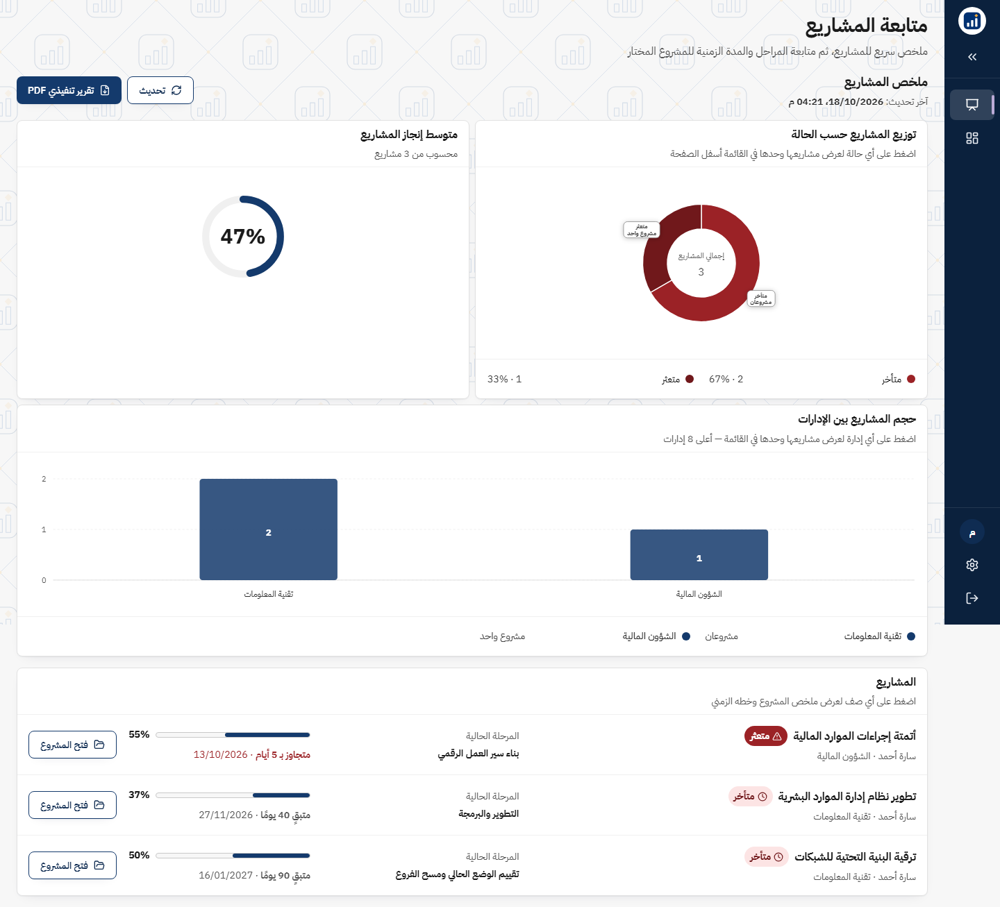
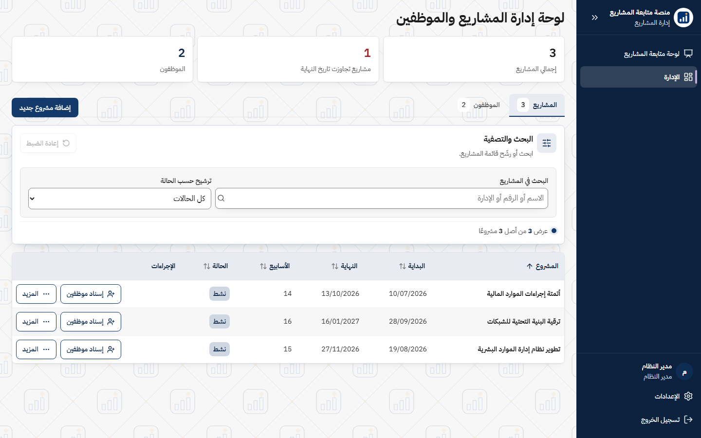
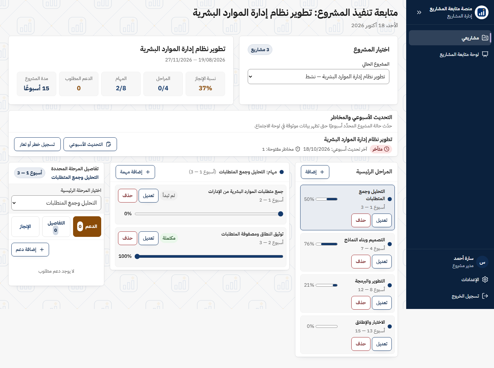
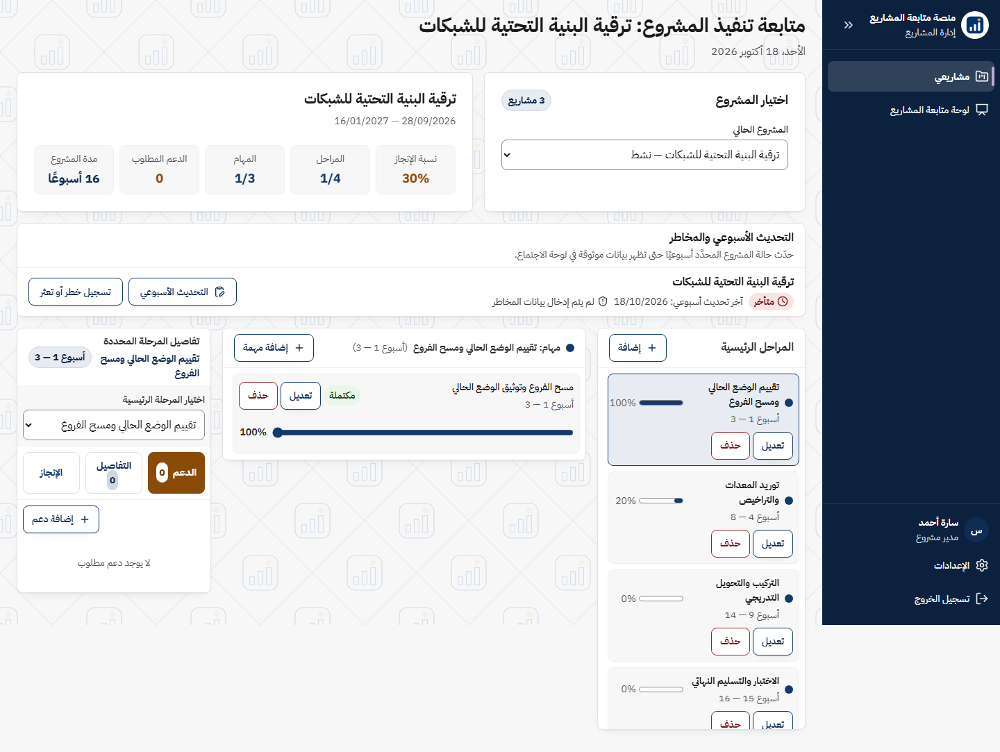

# Project Tracker — منصة متابعة المشاريع

منصة ويب عربية (RTL) لمتابعة تنفيذ المشاريع: المراحل والمهام ونسب الإنجاز، ولوحة متابعة تنفيذية للمحفظة،
وتقارير PDF جاهزة للاجتماعات، وإشعارات بريد بقوالب قابلة للتعديل.

## المزايا

- **لوحة متابعة المشاريع** — مؤشرات المحفظة، الحالة (في المسار / يحتاج انتباه / متأخر)، مخطط Gantt، ومخطط زمني للمشاريع.
- **مساحة مدير المشروع** — المراحل والمهام والمعالم والتحديثات الأسبوعية والمخاطر وطلبات الدعم.
- **الإدارة** — المشاريع والموظفين والإسناد، بثلاثة أدوار: مدير النظام، المدير التنفيذي (عرض وإسناد)، مدير المشروع.
- **تقارير PDF** — تقرير مشروع، تقرير محفظة، وتقرير تنفيذي.
- **إشعارات البريد** — إسناد مشروع، تذكير أسبوعي، اكتمال مشروع؛ بقوالب يحررها مدير النظام مع معاينة وسجل إرسال.
- **الدخول** — بريد إلكتروني وكلمة مرور، مع «نسيت كلمة المرور» عبر رابط يصل للبريد.
- **رمز تحقق SMS (اختياري)** — البنية جاهزة: نفّذ الواجهة `ISmsService` لمزوّد الرسائل لديك وسجّلها في `Program.cs`. بدونها يُتخطّى الرمز.
- **الإدارات** — قائمة «الإدارة المالكة» تُضبط في `Departments:List` بملف الإعدادات.

## لقطات الشاشة

<table>
<tr>
<td width="50%">

**لوحة المتابعة التنفيذية للمحفظة**
مؤشر الإنجاز الإجمالي، توزيع المشاريع حسب الحالة، وحجمها بين الإدارات.



</td>
<td width="50%">

**لوحة الإدارة**
إنشاء المشاريع وإسنادها للموظفين، مع متابعة الحالة والجدول الزمني لكل مشروع.



</td>
</tr>
<tr>
<td width="50%">

**مساحة مدير المشروع**
مراحل رئيسية ومهام بنسب إنجاز مستقلة، وتحديث أسبوعي لصحة التنفيذ.



</td>
<td width="50%">

**تتبّع التعثر والمخاطر**
تسجيل سبب التأخير وربطه بالمرحلة المتأثرة، ليظهر فورًا في لوحة المحفظة.



</td>
</tr>
</table>

## التقنيات

| الطبقة | التقنية |
|---|---|
| الخلفية | ASP.NET Core 8 (C#)، EF Core + SQL مباشر بمعاملات |
| قاعدة البيانات | SQL Server 2016 فما فوق |
| الواجهة | Next.js 16 / React 19 / Tailwind CSS 4 — تُبنى كملفات ثابتة إلى `wwwroot` |
| الاختبارات | xUnit |

## التشغيل السريع

### 1) قاعدة البيانات

افتح [database/INSTALL-ALL-IN-ONE.sql](database/INSTALL-ALL-IN-ONE.sql) في SSMS واضغط F5. ينشئ:

- القاعدة `[ProjectTracker]` وحساب SQL باسم `tracker_user`
- كل الجداول والفهارس وقوالب البريد الافتراضية
- حساب مدير النظام الأول: `admin@example.com` / `ChangeMe#Admin2026!`

> ⚠ غيّر كلمتي المرور الافتراضيتين (القسمان 2 و9 في الملف) قبل التشغيل أو بعد أول دخول مباشرة.

### 2) الإعدادات

أنشئ `ProjectTracker.Web/appsettings.Development.json` (متجاهَل في git):

```json
{
  "Database": { "Server": "localhost", "Name": "ProjectTracker", "User": "tracker_user", "Password": "..." },
  "Security": { "SessionSecret": "اكتب-نصًا-عشوائيًا-من-32-حرفًا-أو-أكثر" }
}
```

اترك `User`/`Password` فارغين لاستعمال مصادقة ويندوز. كل المفاتيح مشروحة بالعربية داخل
[ProjectTracker.Web/appsettings.json](ProjectTracker.Web/appsettings.json)، ويمكن ضبطها بدلًا من ذلك كمتغيرات بيئة
(القائمة في [.env.example](.env.example)).

### 3) التشغيل

```bash
dotnet run --project ProjectTracker.Web      # http://localhost:3000
```

الواجهة المبنية موجودة في `wwwroot`، فلا حاجة إلى Node.js للتشغيل.

## تعديل الواجهة

```bash
cd ProjectTracker.Web/ClientApp
npm ci
npm run build      # يبني الواجهة ثم ينسخها إلى ../wwwroot
```

## الاختبارات

```bash
dotnet test
```

اختبارات التكامل مع قاعدة البيانات تُتخطّى ما لم تضبط `TRACKER_TEST_DB` بسلسلة اتصال لقاعدة تجريبية مثبّت عليها السكربت:

```bash
TRACKER_TEST_DB="Server=localhost;Database=ProjectTracker_Test;Trusted_Connection=True;TrustServerCertificate=True" dotnet test
```

## تخصيص الهوية

- **الشعار:** استبدل `ProjectTracker.Web/ClientApp/public/brand/logo.svg` و`emblem.svg` و`app/icon.svg`.
- **الاسم:** `ProjectTracker.Web/ClientApp/lib/org.ts` (الواجهة) و`ProjectTracker.Web/Services/NotifyTemplates.cs` (رسائل البريد).
- **الألوان:** رموز التصميم في `ProjectTracker.Web/ClientApp/app/globals.css`.

## البنية

```
ProjectTracker.Web/
  Controllers/   واجهات الـAPI والصفحات
  Services/      المنطق: المحفظة، الجلسات، OTP، البريد، الإشعارات
  Data/          EF Core + استعلامات SQL
  Models/        كيانات الجداول
  ClientApp/     مصدر الواجهة (Next.js) — يُبنى إلى wwwroot
  wwwroot/       الواجهة المبنية
ProjectTracker.Web.Tests/   اختبارات xUnit
database/                   سكربت التثبيت الكامل
```

## الترخيص

ملكية عامة — راجع [UNLICENSE](UNLICENSE).
